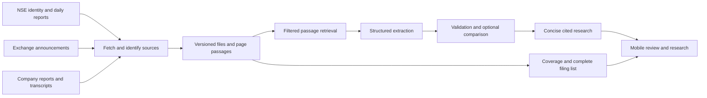

# FINN: final pre-build specification

30 October 2026 · Decision: proceed with specified cuts · Status: specification only

No application has been implemented or deployed as part of this specification. All acceptance checks below are proposed and unrun. The implementation budget is provisionally 16–20 focused hours for one builder; it is not an estimate of work already completed or an assignment requirement.

## 1. Product decision and evidence boundary

**Product promise:** Help an investor identify a portfolio development worth reviewing, understand it through company evidence, and leave with one useful follow-up question.

The target user monitors a small public-equity portfolio and repeatedly moves between exchange filings, company reports and earnings-call commentary. Investor time savings are a hypothesis to test, not a verified benefit.

There are exactly two hero workflows:

1. **Review what changed.** A proactive, prioritised portfolio queue with explicit reasons for attention, expandable routine filings, dated EOD observations, coverage status and reviewed/keep-watching actions.
2. **Investigate a company or event.** One reusable research view, reached from an event or direct ticker entry, with business context, relevant management commentary, evidence gaps and one follow-up question. An expectation/outcome comparison appears only when its comparability gate passes.

The queue supplies a specific research question; research preserves its company, event, period and source context. The distinctive judgment is deciding which claims the available evidence can support, while keeping the investigation short and inspectable.

**Strongest limitation:** document discovery, hosted retrieval and automated financial matching have not been demonstrated beyond manual/source-access checks. Two IT-company examples establish a narrow analytical opportunity, not cross-sector capability. POLYCAB remains a proposed third example, not a completed demonstration.

### Authoritative inputs and resolution of earlier proposals

The [assignment](</Users/aadityarathi/Downloads/ENAM_Holdings/1. ENAM_AI_Engineer_Build_Challenge_Main.pdf>) is authoritative. Its pages 1–2 require a 15–20-company listed portfolio, Push/Pull, a handful of research examples and research that generalises to NSE tickers where data exists. Page 2 specifies the three source types. Pages 2–3 make the feature examples a menu. Pages 3–4 favour useful, focused working behaviour. The [reference](</Users/aadityarathi/Downloads/ENAM_Holdings/2. ENAM_AI_Engineer_Build_Challenge_Reference.pdf>), especially page 2, reinforces primary-source research.

The [feasibility review](</Users/aadityarathi/Downloads/ENAM_Holdings/FINN_Feasibility_Review.md>) and [27-observation audit](</Users/aadityarathi/Downloads/ENAM_Holdings/FINN_Source_Access_Audit.json>) are supplied evidence. Their reported request results are historical point checks; this specification does not relabel them as tests of a deployed application. Instructions quoted within research documents do not authorise implementation, deployment or submission.

| Earlier proposal | Final decision |
|---|---|
| Universal four-quarter promise/delivery verdicts | Remove. Successive annual forecasts must not become four quarterly promises. |
| Broad financial research agent | Restrict output to business context, relevant commentary, evidence gaps and one next question. Allow a bounded user question over the retrieved primary corpus. |
| Automated numerical comparison as the core promise | Optional, disabled by default until validated. The briefing and research must remain useful without it. |
| Fifteen holdings and three research examples | Retain as chosen scope. The assignment allows 15–20 holdings and suggests about 3–5 research examples. |
| Prepared demonstration establishes generalisation | Reject. Require successful cold research on two additional companies. |
| April replay using FY25 annual reports | Reject. Use documents provably available by the replay cutoff, including FY24 annual reports. |

### Fixed portfolio and research examples

Use the review's 15-symbol portfolio: **INFY, HCLTECH, RELIANCE, HDFCBANK, ICICIBANK, BHARTIARTL, LT, MARUTI, HINDUNILVR, SUNPHARMA, ULTRACEMCO, TITAN, TRENT, ASTRAL, CERA**. This is a mock portfolio, without suggested weights or investment recommendations. It varies business types and disclosure layouts; the supplied audit checked symbol identities, not financial merit or current market-cap classifications.

Prepared research candidates are **INFY, HCLTECH and POLYCAB**. Only the first two have the supplied review's inspected source samples. Do not label POLYCAB ready until its primary annual report and transcript are fetched, identified and used successfully. If necessary, replace it with another verified non-IT company and record the reason. Do not remove general ticker entry.

## 2. Exact scope

| Must build | Build if time remains, after core gates | Leave out |
|---|---|---|
| Phone-friendly deployed responsive web application; two connected workflows | Narrow annual company CC revenue-growth expectation checks, after extraction/comparability and usefulness gates | Universal beat/miss verdicts; management credibility scores; investment actions/price targets |
| Fifteen holdings, identities resolved through the NSE security master | A source-backed history of annual forecast revisions for one showcase | Exhaustive multi-year coverage and all eight suggested research sections |
| Working EOD price/volume ingestion and exchange announcement metadata/attachments | Configurable price and volume anomaly badges once a sufficient baseline and adjustment checks exist | Intraday market data and OS/native notifications |
| Annual-report and transcript discovery, retrieval and primary-source research on entered NSE tickers | A few additional filing summaries supported by the same evidence contracts | Biographies, voice, peer comparison and personalised thesis monitoring |
| Default 24-hour live window plus selectable dates; all filings discoverable | More refined event grouping after manual sample review | Portfolio accounting, account onboarding, collaboration and custom dashboard builders |
| Clearly dated historical replay and separate live research entry | Additional animation/presentation refinement after phone verification | Paid document-search services, vector database, external task broker and browser automation unless a proven blocker demands reconsideration |
| Evidence passages, original document links, coverage states, reviewed/watch actions | Broader financial metric extraction with separately validated definitions | Auto-filling missing metrics from news, Screener financial summaries or model memory |
| Three verified research examples, two successful cold-company checks, reproducible setup and authentic AI history | More prepared examples | Hard-coded company answers or company-specific verdict rules |

EOD ingestion is mandatory even if anomaly alerts are cut. Numerical comparisons are not a prerequisite for a useful research view. Source failures may cause honest partial results, but a knowingly broken general research path is a submission blocker.

## 3. Mobile experience

Use four essential surfaces. Queue and research are primary screens; evidence and coverage/preferences can open as full-height sheets. A simple Review/Research navigation remains visible. Keep review state and preferences local to each browser; the fixed portfolio and source cache are shared. No login is required for the assessment prototype.

Use a calm, high-contrast interface with a short event headline, an observable priority reason and a prominent evidence action. Avoid red/green investment verdicts. Do not assign numerical model confidence or predicted price impact. Preserve text labels alongside colour. Test 360–430 px widths, keyboard navigation, focus return and approximately 44 px touch targets.

The copy below is proposed interface text, not a claim about implemented behaviour. Any X/Y values are fictional placeholders until replaced with actual coverage.

### Surface 1: Review

**Purpose/action:** choose a development to inspect; primary action is Open review.

Hierarchy: mode/date banner → ingestion coverage → leading events with priority reason → other events → collapsed routine filings → All filings. A company filter and date selector do not require another screen. Routine items remain accessible through a labelled expandable group and the complete chronological list; collapsed does not mean deleted.

Each card shows company, event timestamp, short observed change, priority reason, related-source count and review state. Separate event time, filing publication time and market trading date. A results filing and an acquisition may share one board bundle while remaining separate events.

Example copy: “Historical replay · 17–30 Apr 2025”; “Results filing published”; “Why shown: annual results”; “Open evidence”; “Routine filings — expand”; “Coverage incomplete: X of Y companies checked.”

| State | Behaviour |
|---|---|
| Loading | Render the shell immediately, then the last successful dated queue if available. Show Checking filings rather than fabricated cards. |
| Empty | Only after successful checks: No announcements found in this period. Keep coverage and All filings visible. |
| Stale | Keep cached events with Checked at [timestamp] and a refresh action. Never label old prices as today's. |
| Partial | State which company/source checks failed. Keep successfully retrieved items; no all-clear conclusion. |
| Failure | Show the failed source category, last successful state and retry. Historical replay remains reachable without masquerading as live data. |

### Surface 2: Company/event research

**Purpose/action:** understand the event or ask a bounded company question; primary action is Inspect evidence.

Hierarchy: company and mode/as-of context → event/question → business context → relevant management commentary → evidence gap and one next question. Add the expectation check only when enabled and eligible. Each section should normally fit in a few sentences; evidence expansion carries the detail.

Direct entry accepts an NSE symbol, resolves identity and starts the same pipeline. Suggested questions include What does this company do?, What is management watching?, and What remains unresolved? A short free-text question uses only the retrieved primary corpus. Event entry pre-fills context; it does not select a different or company-specific analysis engine.

Verified fixture copy, subject to source validation during implementation: “FY25 company revenue growth, constant currency: 4.2%. January range: 4.5%–5.0%. Difference from lower bound: −0.3 percentage points.” Display the target dates and acquisition/scope qualifications adjacent to the comparison. Do not call this evidence of dishonesty or a trading signal.

| State | Behaviour |
|---|---|
| Loading | Show Resolving company → Finding documents → Reading sources → Preparing research, with elapsed time and actual completed stages. |
| Empty | Unknown ticker: identity could not be resolved. Valid ticker without sufficient sources: show which document types were not found. These are different outcomes. |
| Stale | Label the source inventory's last refresh and offer refresh. An old annual report remains a dated source, not an invalid document merely because it is old. |
| Partial | Business context may appear from an annual report while Transcript unavailable is explicit. Do not fabricate commentary. |
| Failure | Preserve the question and any verified passages. Explain the failed stage and allow retry; never silently use model memory. |

### Surface 3: Evidence

**Purpose/action:** verify a claim; primary action is Open original document.

Show company, document type, reporting period, publication availability, source host, PDF page index, printed page/section where known, and a short relevant passage with surrounding qualification. For a comparison, use Earlier statement/Outcome tabs on a phone and side-by-side panels on wider screens. Returning restores the research position and focus.

Offer a same-origin cached PDF endpoint and original URL. A PDF page fragment is a convenience, not a substitute for a visible locator. If a mobile browser does not honour it, the page and passage remain visible. A cached document is identified by content hash and its primary provenance; it is not a newly authored source.

Loading shows document metadata first. No passage means Evidence passage not extracted, without a highlight. An old document keeps its original date. Partial extraction labels missing headers/footnotes. Download failure keeps the verified excerpt and original link, without claiming that the PDF opened successfully.

### Surface 4: Coverage and preferences

**Purpose/action:** understand what was checked and adjust attention rules; primary action is Retry failed checks or Apply preferences.

Separate announcement metadata coverage, attachment processing, EOD data, annual reports and transcripts. Show attempted, successful, failed and last-successful timestamps by company/source. A complete metadata poll is not complete attachment interpretation. Explain the known limits of the chosen exchange channel.

Allow date/mode selection, show/hide reviewed items and priority-category preferences. Price/volume settings appear only when the optional alert feature is enabled and usable. Changing preferences never hides source failures or removes All filings.

Loading uses the last measured inventory. Empty means No checks run yet. Stale identifies overdue checks. Partial lists failures independently of successes. Total failure shows retries and cached replay access, without a misleading coverage percentage.

### Transitions and demonstration

Review card → research with event_id, company_id, question, mode and cutoff → evidence → research → mark reviewed/keep watching → return to the preserved queue. Direct ticker entry → identity confirmation → the same research surface. Switching historical/live clears incompatible research state and uses a separately keyed corpus.

The three-minute phone demonstration is a script to validate, not a latency promise:

| Time | Action and visible proof |
|---|---|
| 0:00–0:25 | Open Historical replay; show 15 holdings, 17–30 April 2025 and evidence cutoff 30 April 2025, 23:59 IST, plus honest coverage. |
| 0:25–0:55 | Open a results event, explain its priority and reveal associated filings; show a distinct event sharing the same bundle if verified. |
| 0:55–1:40 | Inspect Infosys's January statement and annual outcome, including periods and the 0.3 percentage-point difference if the optional comparison has passed its gates. Otherwise inspect the two source passages without an automated verdict. |
| 1:40–2:05 | Show the acquisition/scope qualification and the next research question; complete Reviewed or Keep watching. |
| 2:05–2:30 | Open HCLTECH through direct ticker entry to show the same research process. |
| 2:30–3:00 | Switch visibly to Live research and submit an evaluator-selected unfamiliar ticker. Show genuine progress; continue the cold run beyond the script if necessary. Do not present a cached showcase answer as a cold result. |

## 4. Evidence and financial-data contracts

Use stable internal IDs and ISO timestamps stored in UTC, displayed in IST. Publication time, call/event date, reporting period and retrieval time are separate. Store unknown values as null with a reason, not guessed timestamps or zeros. Every factual research claim must resolve to evidence records.

| Record | Minimum fields |
|---|---|
| Company | company_id; legal name; NSE symbol; exchange; ISIN; series; identity source; resolved_at; symbol aliases where established |
| Announcement | announcement_id; company_id; exchange record/source key; original subject/description; event date if known; published_at; availability evidence; retrieved_at; attachment IDs; category; event links; priority reasons; check status |
| Event | event_id; company_id; event type; relevant period; linked announcement/document IDs; observed change; evidence IDs; priority reasons; generated_at; unresolved classification flags |
| Document/version | document_id/version_id; company_id; type; original and final source URL; primary host; discovery URL; content hash; file bytes/type; PDF page count; period; document date; published_at and precision/proof; retrieved_at; parse status; supersedes/replaces links |
| Passage | passage_id; version_id; one-based PDF page; printed page/section if identifiable; speaker; exact supporting text and surrounding qualification; optional bounding box; extraction status |
| Extracted fact | fact_id; company_id/entity scope; metric definition; period start/end or point-in-time date; period kind; original value/text; unit; currency; reporting/accounting basis; CC/reported/organic treatment; segment/scope; evidence IDs; extraction status |
| Management statement | statement_id; speaker; exact wording; statement/call date; publication availability; target dates; numerical range or qualitative expectation; metric tuple; conditions/acquisition assumptions; revision links; evidence IDs; revision-search coverage |
| Calculation/comparison | calculation_id; input fact/statement IDs; formula/version; matching fields; normalisation steps; result and unit; comparability status; failed checks; evidence IDs; computed_at |
| Research output | research_id; company/event/question; mode/cutoff; eligible document version IDs; business context; commentary; observations/calculations/interpretations labelled separately; gaps; one next question; citations per claim; model/prompt versions; generated_at; coverage |
| Market observation | company/ISIN/symbol/series; trading date; close; previous close if source provides it; volume and unit; raw/adjusted basis; source file/hash/schema; retrieved_at; validation status |
| Job/check/cache | job_id/idempotency key; stage/state; attempts; source errors; deadlines; timestamps; usage/cost reservations; corpus fingerprint; schema/model/prompt versions; last successful result |

### Status vocabulary and mandatory gates

Acquisition, basis and period qualifiers are fields, not optional prose footnotes. Preserve both original and normalised values. For percentages, store growth rates separately from monetary values. Differences between rates use percentage points; 0.3 percentage points equals 30 basis points, not 0.3% relative growth.

Retrieval states: not_attempted, fetched, blocked, not_found, invalid_document, timeout. Extraction states: extracted, partial, failed, ambiguous. Comparison states: eligible, outcome_pending, insufficient_evidence, not_comparable, conflicting_evidence. Eligibility is not the final outcome label; an eligible comparison may be within, below or above a range.

Only compare after matching company/entity scope, metric definition, target dates, period kind, unit/currency treatment, reporting basis, segment/acquisition scope and relevant qualifications. Confirm that the guidance existed before the outcome and identify whether revision coverage is complete enough. If revision coverage is incomplete, label it Comparison to the retrieved January statement rather than Latest guidance or Final promise.

| Condition | Required response |
|---|---|
| A needed document/passage/header/qualification is absent or unreadable | Insufficient evidence; identify the missing item. No numerical verdict. |
| Both values exist but entity, definition, dates or treatment differ | Not comparable; name the failed fields. |
| Annual target has not reached its outcome | Outcome pending, even if quarterly progress is available. |
| Conflicting sources remain unresolved | Conflicting evidence; show both source vintages. |
| Retrieved passages contain no explicit target | No comparable target found in retrieved passages. Do not claim the company gave no guidance anywhere. |
| A source explicitly states a metric was not disclosed | Not disclosed, with that evidence. This is distinct from not found. |
| A range is valid and outcome comparable | Deterministic within/below/above check. Compute distance to the relevant bound and label the specific statement compared. |

Do not substitute standalone for consolidated, total PAT for attributable PAT, EBIT for EBITDA, operating profit for a differently defined metric, company revenue for services revenue, or reported growth for constant-currency growth. Banks need appropriate disclosed metrics; a universal industrial-metric template is out of scope.

Do not average quarterly growth rates into annual growth. Derived quarters, Q4 subtraction and reconstructed EBITDA are omitted from the first version. Unit scaling is allowed only with compatible definitions and explicit provenance. Never silently repair a source typo. Preserve amended values and their publication dates.

### Audited fixtures to import and revalidate

These values are supported by the supplied feasibility review; implementation must associate its own downloaded hashes/passages before marking automated checks passed.

| Fixture | Intended assertion and boundary |
|---|---|
| INFY January FY25 statement versus annual outcome | Group annual CC revenue growth range 4.5%–5.0%, outcome 4.2%: 0.3 percentage points below the lower bound. Not comparable to Q4-only growth of 4.8% or annual reported USD growth of 3.9%. |
| HCLTECH January FY25 statement versus annual outcome | Company annual CC revenue growth range 4.5%–5.0%, disclosed outcome 4.7%: within the range. Preserve the approximately 50-basis-point HPE CTG acquisition contribution assumption; do not infer organic growth. |
| INFY opening FY25 forecast | The April 2024 1%–3% forecast excluded in-tech; subsequent guidance incorporated the acquisition. An original-versus-final beat badge without scope treatment is invalid. |
| HCLTECH audited PAT | Total and attributable profit are distinct fields. The review reports 17,399 crore versus 17,390 crore; this is not a contradiction to resolve by choosing a favourite number. |

### Historical availability contract

Freeze replay to **filings 17–30 April 2025, with evidence available by 30 April 2025, 23:59 IST**. Use FY2023–24 annual reports. Exclude the later FY25 annual reports. Infosys's April call transcript is eligible only from the verified 22 April 2025 21:32:35 exchange dissemination; HCLTech's only from 25 April 2025 22:14:05. Call date does not establish transcript availability.

Every eligible version needs an availability timestamp backed by filing/publication evidence. Retrieval in October 2026 is not proof of availability in April 2025. Uncertain availability excludes the document from replay until resolved. An earlier verified company publication can qualify only when recorded with evidence, not inferred from a directory name.

One remaining replay gap needs explicit attention: the supplied review inspected HCLTech's January transcript, but the audit does not establish its exact public publication time. Locate a dated exchange filing or other contemporaneous primary publication evidence before using that transcript in the April replay. The call date and filename alone do not close this gap. A date-only verified publication is represented conservatively as available by the end of that date, with its precision recorded; a mere document date is not automatically a publication date.

The mandatory replay uses one fixed cutoff; an arbitrary time-travel slider is excluded. Date filters select the displayed filing window without silently altering the declared evidence cutoff. Any later addition of an adjustable cutoff must filter facts, documents, revisions, summaries and caches before retrieval/generation, not merely hide cards afterward. Each derived result inherits the latest availability time of its supporting inputs.

## 5. Smallest suitable architecture

**Chosen stack:** React + TypeScript + Vite for a static mobile interface; Python FastAPI + Pydantic for HTTP/contracts; httpx for retrieval; pypdf for text-first PDF reading with selective pdfplumber table inspection; SQLite plus FTS5 for metadata, jobs and passage search; original files on local persistent storage. No vector database or external broker.

Build the frontend once and serve it from FastAPI on the same origin. Run one container on one Render web service with a persistent disk, one application worker and one bounded job consumer. Store SQLite and source files beneath the mounted data directory. This is a small assessment deployment, not a horizontal-scaling architecture. Browser-local reviewed/watch/preferences state avoids account infrastructure and shared-user confusion.

Pin dependency versions after the first working environment/host check and retain lockfiles. Confirm FTS5 availability and direct navigation to research URLs in that environment. No dependency installation or application scaffolding has been performed in this phase.

Vite documents static production bundles; FastAPI supports static/file responses; FTS5 supplies text search with ranking. Render documents that default storage is ephemeral and persistent disks require a paid service, are limited to one instance and affect deployment availability. The host choice is a proposal, not a provisioned resource or a verified current quote. Validate memory on the largest selected report before choosing the service size. [Vite](https://vite.dev/guide/build), [FastAPI static files](https://fastapi.tiangolo.com/tutorial/static-files/), [SQLite FTS5](https://www.sqlite.org/fts5.html), [Render disks](https://render.com/docs/disks).

### Retrieval, parsing and new-company path

1. **Resolve identity.** Refresh the NSE security master and resolve symbol to legal company/ISIN/series. Use aliases only when supported. All 15 portfolio identities and new entries use this path.
2. **Discover source links.** Query the exchange announcement channel and a document directory such as the Screener company document section; use the latter only to locate company/exchange annual-report and transcript URLs. Its financial summaries and AI summaries never enter the research corpus. If unavailable, inspect the verified company IR index. Validate company identity and document contents after following a link. A hard-coded showcase manifest is allowed for reproducible replay, not as the sole live discovery method.
3. **Fetch.** Record each attempt and actual final URL. Follow an alternate primary-host copy when available. Validate public HTTPS destinations/redirects, byte signatures and document identity; a 200 HTML error page is not a PDF. application/octet-stream can be a PDF if bytes validate. Bound download size initially to 50 MB and 600 PDF pages, sufficient for the reviewed examples, and expose larger/unreadable files as limited coverage. No browser/cookie bypass is assumed.
4. **Parse/index.** Extract page text incrementally and preserve PDF/printed-page differences and speaker sections. Cache page extraction by content hash/parser version. Inspect only relevant tables with headers, units and footnotes; ambiguous columns block numeric extraction. Do not send 380 pages wholesale to a model. Broad OCR is excluded; unreadable scans produce a specific gap.
5. **Retrieve.** Filter by company, mode, proven publication availability, document type and period before search. Use FTS5 and deterministic question/metric vocabulary. Select up to roughly 12 passages, including neighbouring qualifications, within a 24,000-input-token planning budget. Retrieve annual-report context and transcript commentary separately so one document type does not crowd out the other. These are initial limits to validate, not recall guarantees.
6. **Extract.** Use a strict schema with nulls/status fields, source IDs and exact passage references. The model proposes facts and statements; it does not create company identities, dates, source URLs or numerical verdicts from memory.
7. **Normalise/validate.** Check citation membership, source text support, unit/basis/period identity and completeness. Arithmetic, range matching, priority rules and coverage counting are deterministic. A schema-valid response is not evidence of financial correctness.
8. **Present.** Generate concise prose from validated records and the eligible evidence set. Suppress unsupported claims. Persist the corpus fingerprint, citations, costs and versions so a result is reproducible and invalidatable.

Cold research initially seeks one latest eligible annual report and up to two relevant transcripts, plus the current event filing if present. This bounded corpus supports useful context, not exhaustive research or proof that no other guidance exists. Any numerical comparison requires further qualified source discovery and remains optional.

The source audit's historical security-wise CSV samples remain valid replay candidates. For live EOD ingestion, discover the current report from the [NSE report catalogue](https://www.nseindia.com/all-reports) and validate its schema/date. NSE lists UDiFF final bhavcopy and marks some older bhavcopy formats discontinued. Do not assume a remembered legacy filename is the live feed. Record adapter/schema version and filter the correct security series/ISIN. A date without a report is not automatically a trading day; use report availability and dated trading-calendar evidence.

### Jobs, refresh and failures

Return a job ID promptly for cold research; poll its stage from the browser every approximately two seconds. Persist queued/running/completed/partial/failed states and an idempotency key. A single bounded consumer uses a separate execution context for PDF parsing so HTTP remains responsive. On restart, mark interrupted jobs retryable and resume only idempotent stages; do not claim exactly-once execution.

Use one lightweight scheduler in the single application instance: announcement refresh approximately every 15 minutes and EOD refresh after the relevant market report is available. Record every success/failure. This is periodic in-app intelligence, not instantaneous or intraday notification. The user can retry a failed check without forcing a full portfolio re-ingestion. FastAPI's lightweight background task facility is not a durable job queue; SQLite job state and bounded processing are deliberate prototype constraints. [FastAPI background-task guidance](https://fastapi.tiangolo.com/tutorial/background-tasks/).

Limit publisher requests to two concurrent fetches and one PDF parse, initially. Use a connection timeout around 10 seconds, individual source-attempt deadline around 30 seconds, one bounded retry for transient errors, and no rapid retries of blocked responses. A research run has an approximately 180-second initial deadline and must return partial/gap states rather than spin indefinitely. The useful cold-run target is 120 seconds, unmeasured. Do not reject all data because one source timed out.

Indicative HTTP contracts are GET portfolio queue/coverage, POST research, GET job status, GET evidence/document, and a protected builder-only refresh route. Research requests contain symbol, question, optional event, mode and cutoff. Evidence routes accept internal IDs, not arbitrary fetch URLs. Runtime keys stay server-side. Rate-limit public cold jobs and reserve budget before calls; no login system is needed.

### Deduplication, amendments and attention rules

Keep every original exchange record. Identify byte-identical attachments by hash while retaining all publication/provenance records. A PDF and its exchange cover version can be linked as copies only after identity/content validation; do not assume equal page numbers. Changed bytes create a version, not silent overwrite. Supersession needs explicit amendment evidence or a confirmed replacement relationship. Ambiguous revisions remain visible.

Group events conservatively by company, event type and reporting/event period with supporting evidence. One document may support several events; several documents may support one event. Unknown classifications remain visible. Amendment signals reopen the relevant event; Reviewed does not suppress a later material update. Browser-local review state should therefore include the event's evidence/version fingerprint.

Use explainable attention tiers: substantive results/transactions/management or regulatory changes first, routine publication/compliance notices collapsed, and ambiguous documents visible for review. These are workflow priorities, not predictions of material stock-price impact. Audit generic Updates labels rather than automatically hiding them. No model-only importance number.

Optional EOD alerts use absolute close-to-previous-close percentage change and current volume divided by the mean of 20 previous completed sessions, excluding the current session. Defaults of 5% and 2× are proposed settings, not assignment requirements or empirical significance thresholds. Require a valid nonzero previous close/baseline; suppress invalid volume ratios and flag known corporate-action discontinuities. If adjustment/continuity cannot be established, label raw observations and disable the affected anomaly verdict. EOD moves preceding an after-close filing are not presented as reactions to it. Evaluate preferences through deterministic rules and keep market dates visible.

### Cache and grounding rules

| Item | Cache/invalidation policy |
|---|---|
| NSE identity inventory | Refresh daily; preserve identity source/date and aliases. Unknown symbol triggers a fresh lookup before rejection. |
| Announcement metadata | Refresh at the declared interval. Failed refresh keeps old rows visibly stale. Track requested date ranges and failures. |
| Original PDF/text | Immutable by content hash; new bytes create a version. Retry discovery of previously missing links on explicit refresh. |
| Document inventory | Refresh after relevant new filings and at least daily in live mode. Version invalidates dependent outputs. |
| EOD bars | Key by security/date/source version; refresh latest available date and corrections. Never treat a cached previous session as today's close. |
| Research | Key by company/question/event, mode/cutoff, document-version set, prompt/schema/model versions. Live display rechecks inventory after about one hour; replay uses its immutable manifest. No cross-mode reuse. |

Source text is untrusted data, delimited separately from instructions. Do not execute instructions, follow action requests or accept fabricated citations found inside a PDF. The model receives only vetted evidence IDs and cannot browse news or invent URLs. Validate all returned citation IDs and numeric support. Embedded document links are discovery candidates, not automatic authority. If prompt-injection or contradictory evidence prevents faithful extraction, return a gap and preserve the source for inspection.

## 6. Model selection and cost controls

**Builder model:** GPT-6.1 Sol Extra High can assist implementation and difficult reviews. Its availability in a subscription does not establish the runtime app's credentials, billing arrangement or quota. Runtime access must be verified separately.

**Initial runtime candidates:** evaluate `gpt-6-luna` at low effort for bounded extraction and short research synthesis, against `gpt-6.1-sol` at medium effort for the same tasks. Choose the lightest passing setting. Escalation is allowed once for an otherwise adequate evidence packet that the lighter model mishandles; missing evidence is not repaired by a stronger model. Arithmetic and comparability decisions remain deterministic.

Official pages checked on 30 October 2026 list Responses API/structured-output support. Standard short-context text rates per million tokens are Luna $0.10 input/$0.50 output and Sol $2 input/$10 output. Cache writes, other processing modes, tools and longer contexts can change the bill. These are published rates, not measured application costs. [Luna](https://developers.openai.com/api/docs/models/gpt-6-luna), [Sol](https://developers.openai.com/api/docs/models/gpt-6.1-sol).

Structured Outputs constrain the format; the documentation explicitly notes that outputs can still contain mistakes. Validate evidence and handle refusal/incomplete responses rather than accepting schema compliance as truth. [Structured Outputs](https://developers.openai.com/api/docs/guides/structured-outputs).

### Small model evaluation

Prepare ten manually labelled evidence packets: six extraction cases and four synthesis/abstention cases. Include both verified company pairs, the acquisition-scope mismatch, wrong-period/wrong-basis distractors, a missing passage, ambiguous table columns, and a document containing an instruction the system must ignore. Some cases may combine these properties. Keep the later non-IT cold test as additional validation rather than pretending the IT sample establishes generalisation.

Run identical packets and schemas on both candidates. Record critical field errors, supported/missing claims, citation correctness, appropriate abstention, completeness, actual latency and billed token usage. Require all critical identity/period/basis/qualifier fields correct and no unsupported numerical verdict in this small set. Prefer the cheaper/faster passing model after auditing omissions. A stronger model's agreement is not independent evidence.

Automated comparisons stay disabled unless the same fields/rules pass both fixtures and a non-IT case, with no bespoke company verdict code, and a small task-time check shows the comparison adds useful value. If no comparable non-IT pair can be established within the timebox, retain general research but omit the automatic comparison from the submitted feature claim.

### Spending and latency limits

Proposed application-API ceiling: **US$10 total for implementation/evaluation and the assessment demonstration**, including up to $2 for the model evaluation. Proposed hosting ceiling: **US$15 for the first month**; the actual quote and account availability are unverified. These are design limits, not resources purchased or spend already incurred. Keep the builder's subscription usage separate.

As an illustration only, 20,000 uncached input tokens plus 2,000 billed output tokens cost about $0.003 on Luna or $0.06 on Sol at the listed base rates. Actual output includes applicable reasoning usage; cache writes/tool charges and different processing modes are excluded from that illustration. Measure actual per-run cost before making efficiency claims.

Start with maximum 24,000 input tokens per model call, a configured output-token cap, no more than four extraction calls plus one synthesis per research job, and at most one Sol escalation. These budgets require validation against actual SDK accounting and incomplete-output behaviour. Use an application-side cost ledger, reserve a conservative upper bound before each call, reconcile provider usage, and refuse new calls that would exceed remaining budget. Initially cap a cold job at an estimated $0.50. Configure provider project limits/alerts where supported; do not assume they alone guarantee a hard cap.

At 80% of the application cap, disable optional escalation/backfills. At the cap or quota exhaustion, serve previously validated results and source passages with generated-at labels; new unsupported research returns Model access unavailable. Ingestion and evidence browsing may continue. Never switch to fabricated prose, an unconfigured provider or model memory. Restrict public cold requests to one active job per browser, a small global queue and a conservative daily allowance; deduplicate identical jobs.

Targets to measure: cached queue usable in about two seconds; cached research about three seconds; cold research about 120 seconds with partial output by the 180-second deadline. These are acceptance targets, not observed performance or guarantees.

## 7. Acceptance criteria and required proof

All checks begin **UNRUN**. A screenshot alone is insufficient for data correctness. Save source hashes, cited passages, expected/actual records, request/job logs and phone captures as appropriate. The following tests exercise financial and workflow behaviour rather than duplicating implementation details.

| ID / scenario | Expected behaviour | Evidence required to pass |
|---|---|---|
| A01: 15-symbol portfolio | Correct legal identities/ISIN/series, with distinct holdings | Security-master snapshot and resolved records for all 15 |
| A02: EOD samples and current date | Parse both audited historical dates and a current published report; preserve close, volume, series and dates | Raw files/hashes, schema version, audited rows and hosted retrieval logs |
| A03: Portfolio filings | Check the requested window for every holding; show failures; retain underlying records/attachments | Source responses, counts by company/date and manually checked sample |
| A04: Byte duplicates | Identical attachments appear once as content, with provenance preserved | Two source records and one content hash; complete filing list |
| A05: Multi-event bundle | Results and acquisition remain separately discoverable despite a common PDF | Hand-labelled bundle passages and resulting event links |
| A06: Amendment | New version preserves original, changes dependent output and reopens stale review status | Original/replacement files, timestamps, relation and UI result |
| A07: Units/basis | Keep consolidated/standalone, company/services, total/attributable and currency treatments distinct | Reviewed source headers/footnotes and extracted field comparison |
| A08: INFY optional comparison | 4.2% versus January 4.5%–5% gives −0.3 percentage points to lower bound; no causal/investment claim | Validated source passages plus deterministic calculation record |
| A09: HCLTECH optional comparison | 4.7% within 4.5%–5%; acquisition assumption retained | Same extraction schema/rules and reviewed source references |
| A10: Wrong period/metric | Reject quarterly growth versus annual target, CC versus reported and EBIT versus EBITDA | Negative-case output with exact failed fields |
| A11: Revised/conditional scope | Preserve supersession and conditions; original acquisition-excluded range is not silently scored against changed scope | Revision evidence and blocked/qualified comparison |
| A12: Missing target/outcome | Missing is not zero or missed; annual future outcome stays pending | Missing/partial packet and output status |
| A13: Conflicting/table-ambiguous evidence | No confident number selected from detached columns or unresolved contradictions | Source-page inspection and explicit gap/conflict result |
| A14: Citations | Every factual claim resolves to correct company/document/page/passage; both evidence tabs work | Full audit of demo claims and several cold-run claims, plus mobile opening |
| A15: Publication cutoff | April replay excludes FY25 annual reports and transcripts before proven publication | Manifest audit; earlier-cutoff negative fixture; no later source in output/cache |
| A16: Market/event chronology | After-close filing is not used to explain preceding EOD movement | Timestamp/trading-date fixture and displayed language |
| A17: Optional threshold boundaries | Deterministic configurable comparison, current session excluded from baseline, insufficient history disables ratio | Valid 21-session data and synthetic boundary cases clearly labelled as tests |
| A18: Quiet versus failed feed | Complete quiet checks show no items; failed/partial checks show coverage gaps | Controlled empty, stale and blocked responses with phone captures |
| A19: Prepared research | Three verified companies have useful annual-report context and transcript commentary from the same pipeline | Source inventory/hashes, research outputs and citation audit; POLYCAB not pre-certified |
| A20: Successful unseen-company research | Two non-demo tickers from different sectors, including a smaller issuer, discover and use an AR and transcript with empty caches | Hosted cold-run logs, no prefilled URLs/answers, elapsed time and manual source audit |
| A21: Unavailable company/source | Unknown identity, blocked source and unreadable document yield distinct honest states | Failure fixtures and bounded partial results; these do not substitute for A20 |
| A22: Primary-source isolation | Financial statements use only eligible company/exchange documents; discovery summaries/news/model memory are excluded | Eligible-corpus trace and all claim citations |
| A23: Document instructions | Embedded instruction cannot change task, trigger actions or introduce unsupported citations | Adversarial text packet, trace and expected abstention/faithful extraction |
| A24: Job restart/budget | Interrupted work is visible/retryable; quota and budget exhaustion cause no uncontrolled calls or invented results | Restart logs, idempotency checks and cost-reservation reconciliation |
| A25: Mobile workflow | No horizontal overflow at 360–430 px; evidence/return/state/date entry work on phone; keyboard/focus usable | Real phone run and viewport captures of the four surfaces |
| A26: Useful task completion | Five review tasks completed with correct important changes and no missed material test items; aim for ≥30% median task-time reduction | Counterbalanced baseline/FINN timing sheet, correctness and misses; label small-sample limitations |
| A27: Deployment/reproducibility | Public URL works after restart; data persists/rebuilds correctly; documented fresh setup works | Hosted smoke run, restart check and independent setup log |

The baseline can ship without A08–A11's automatic comparison capability, but research still must preserve conditions and avoid invalid conclusions. A17 is conditional on including anomaly alerts. A20 is a mandatory successful generalisation check when the selected public documents are available; transparent failure alone does not pass it.

For A26, seek two representative reviewers and five comparable events. Counterbalance task order to reduce familiarity effects; measure time to identify the change and inspect evidence, not reading speed alone. User availability is unresolved. If only the builder can test, label it a self-test, do not claim validated investor time savings, and keep the optional comparison disabled unless the other early gates and a useful task check support it. Failure calls for shorter/reordered screens, not more features.

## 8. Implementation sequence and exit gates

Hours are estimates measured from implementation start. This specification does not authorise deployment now. Once the implementation phase is requested, keep the first deployment small and use it to expose host-access problems early.

| Elapsed budget | Work and concrete exit condition | Gate/scope cut |
|---|---|---|
| 0–1 h | Inspect available repository/runtime/credentials; define contracts; prepare minimal UI shell and server deployment path | Confirm host and API access without inventing credentials or creating unapproved charges |
| 1–3.5 h | Bring up minimal hosted shell and prove one real path: identity → source retrieval → page passage → bounded research → working evidence action | At 3.5 h, a screenshot plus disconnected modules is not sufficient. Remove optional comparisons immediately if behind; solve source access before polish |
| 3.5–6 h | Cold-start two other-sector companies on the intended host; make document discovery reusable; establish third prepared example | No ticker-specific final answers/financial rules. If AR/transcript access fails, repair the source path. Do not disguise a showcase as generalisation |
| 6–8.5 h | Load 15 holdings, fetch EOD data/filings, build versioned event links and dated replay manifest | Complete source/coverage records for portfolio; at least the inspected replay paths are reproducible; latest live feed tested |
| 8.5–11 h | Finish Review/Research/Evidence/Coverage interactions, local review state and concise sourced output | First working version must meet the baseline exit criteria below. Drop advanced grouping/animations and all optional numerical/alert features if late |
| 11–12 h | Run small model/task checks; choose one optional enhancement only if gates pass | Prefer validated comparison or alerts based on observed progress, not both by default. If useful evidence is missing, leave both out |
| 12–16 h | Protected integration reserve: correctness/negative tests, phone run, hosted restart, replay isolation, cold-run proof, README/history/submission preparation | No new features. Fix source/citation/cold-research failures before visual refinements |
| 16–20 h, only if available | Contingency for an identified blocker, repeated verification after fixes or a previously gated small enhancement | Do not expand the reserve into a broad roadmap; preserve a working release |

First working version exit criteria: public phone URL; 15 resolved holdings; working dated price/volume and exchange records; one connected event-to-source-to-research path; useful direct research for three verified examples; two successful cold-company checks; visible source gaps; replay/live separation; factual citations; a restart that does not silently lose source/job truth. If these cannot be met, report the specific gap rather than mark the prototype ready.

The thin fallback removes comparisons, long revision timelines, advanced grouping and optional anomaly alerts. It retains the portfolio briefing, all three working sources, general ticker research, evidence and phone delivery. Failure to retrieve primary documents across unfamiliar available-data tickers remains a blocker; it is not resolved by cutting the requirement.

## 9. Submission readiness

The deadline is Sunday, **1 November 2026**. The brief supplies no cutoff time or timezone. Use internal readiness before that date rather than assume a final-hour deadline. No submission has been sent.

| Required item | Preparation and evidence |
|---|---|
| Phone-accessible prototype | HTTPS URL, no broken access gate, mode/date labels, clear entry, tested on an actual phone; credentials only if an unavoidable access gate exists |
| GitHub repository | Accessible repository link, setup instructions, configuration example without keys, architecture/source notes, replay manifest, checks and known limitations |
| Authentic AI build history | Preserve this planning sequence and actual coding-agent/LLM conversations using supported exports/share links. Verify evaluator access. Include failures and genuine decisions. A decision log is supplementary, not a replacement |
| Covering-email writeup | What was built; decisions/trade-offs; deliberate omissions; next steps. Report only measured checks/costs and truthful limitations; distinguish replay from live research |

Send links/attachments to **assessment@enam.com**, exact subject **ENAM - IIT screening - 2027**. This is the submission instruction to follow in the later submission phase, not an instruction to send an email now.

## 10. Source register and unresolved decisions

### Supplied verified source candidates

The statuses below are imported from the feasibility review/audit, not fresh hosted tests. Import raw content with hashes during implementation; do not assume files already exist locally just because URLs were audited.

| Source | URL / locator | Use and limits |
|---|---|---|
| NSE identity master | https://nsearchives.nseindia.com/content/equities/EQUITY_L.csv | Audited identity list; refresh current identities separately from historical membership |
| Historical EOD | https://nsearchives.nseindia.com/products/content/sec_bhavdata_full_17042025.csv and https://nsearchives.nseindia.com/products/content/sec_bhavdata_full_22042025.csv | Two parsed samples; no baseline/latest-day completeness proven |
| INFY feed | https://www.nseindia.com/api/corporate-announcements?index=equities&symbol=INFY&from_date=17-04-2025&to_date=30-04-2025 | Audited public website endpoint; no contractual stability or hosted completeness claim |
| HCLTECH feed | https://www.nseindia.com/api/corporate-announcements?index=equities&symbol=HCLTECH&from_date=22-04-2025&to_date=30-04-2025 | Same limits; retain distinct related filing types |
| INFY FY24 AR | https://nsearchives.nseindia.com/corporate/INFY_03062024153620_infosysar24.pdf | Audited 353-page exchange copy; replay business context |
| HCLTECH FY24 AR/AGM | https://nsearchives.nseindia.com/corporate/HCLTECH_22072024183910_HCLTechAGM2024.pdf | Audited 385-page exchange bundle; distinguish notice and report |
| INFY January statement | https://nsearchives.nseindia.com/corporate/Infosys_21012025151633_SEfiling_Earningscalltranscript.pdf | PDF p. 24 / printed earnings-call p. 4; separate media/investor call sections |
| INFY April outcome | https://nsearchives.nseindia.com/corporate/Infosys_17042025162119_BM_Outcome_April172025.pdf | 380-page bundle, fact sheet PDF p. 19; direct company release had request errors in audit |
| INFY April transcript | https://nsearchives.nseindia.com/corporate/Infosys_22042025213147_SEfiling_Earningscalltranscript.pdf | 48 pages; publication cutoff matters |
| HCLTECH January statement | https://www.hcltech.com/sites/default/files/documents/investor-reports/HCLTech-Earnings-Jan13-2025_1.pdf | p. 10 and surrounding qualifications; PDF may be served as octet-stream |
| HCLTECH April outcome | https://nsearchives.nseindia.com/corporate/HCLTECH_22042025175316_InvestorRelease_1.pdf | PDF p. 4 / release slide 3; CC measure from company release |
| HCLTECH audited accounts | https://www.hcltech.com/sites/default/files/documents/investor-reports/Audited-Financial-Results-for-the-quarter-and-year-ended-March-31-2025.pdf | p. 2 table requires full column/header context |
| HCLTECH April transcript | https://nsearchives.nseindia.com/corporate/HCLTECH_25042025221345_TranscriptEarningsCall.pdf | 26-page exchange copy; eligible only from proven publication |

### Additional navigation/technical checks during this specification

The [POLYCAB document index](https://www.screener.in/company/POLYCAB/consolidated/) was opened and its annual-report/transcript link sections inspected. That is a discovery observation only: this step did not download or audit the primary POLYCAB documents and does not upgrade it to demo-ready. No Screener company summary or financial table is used as Pull evidence.

Current official documentation was opened for the runtime model rates/features, Structured Outputs, Vite production builds, FTS5, FastAPI background work and Render disks. These checks inform architecture; they do not establish that our as-yet-unbuilt application works. The Render pricing page did not provide an inspectable quote in the fetched text, so hosting price remains unverified.

| Unresolved item | Default decision | Required verification |
|---|---|---|
| Intended host/API account and memory/price | One FastAPI/React service with persistent storage; $10 API and $15 first-month hosting proposal | Confirm access/quote and parse the largest selected report without exhausting memory; do not provision now |
| Hosted discovery and newest EOD format | NSE identity/reports/announcements plus document-link discovery from company/Screener indexes | First vertical slice and two cold non-IT runs; successful current report parsing |
| Third prepared example | POLYCAB pending | Fetch an AR and transcript, validate primary identity/availability, extract useful evidence; replace if necessary |
| Replay publication proof | HCLTECH January transcript excluded until established | Locate contemporaneous primary publication evidence; do not use call date or filename as proof |
| Reusable comparisons | Disabled initially | Same rules on two supplied fixtures and a non-IT case, all citations/qualifications audited |
| Investor usefulness | Hypothesis | Five tasks with representative reviewers if available; report self-test limitations honestly |

## 11. Implementation handoff

**Build:** a mobile portfolio review queue and general primary-source research, using 15 fixed holdings, three verified examples, a fixed April 2025 replay and separate live ticker entry. Research contains business context, management commentary, evidence gaps and one follow-up. Comparisons and anomaly alerts are optional, gated enhancements.

**Architecture:** one React/Vite frontend served by Python FastAPI, Pydantic contracts, bounded HTTP/PDF processing, SQLite/FTS5 and versioned files on a persistent disk. One instance, one bounded job consumer, no vector database or external broker. Use Luna/Sol only after a small evidence evaluation; arithmetic and financial matching stay deterministic.

**Evidence:** start from the supplied audit's NSE identity/daily files, exchange announcement records, FY24 reports and dated INFY/HCLTECH transcripts/results above. Audit results are source candidates, not a completed runtime. POLYCAB's primary coverage, HCLTECH January transcript publication proof for replay, and all hosted cold paths remain unresolved.

**Required proof:** correct identity/units/periods, usable citations, no future evidence in replay, visible partial ingestion, working phone navigation and two successful unfamiliar-company runs from the intended host. Record actual costs, time and limitations. Disable automated comparisons on critical extraction/matching failure; do not substitute company-specific answers.

**First concrete coding task, once implementation is requested:** create the minimal contracts and server/UI shell, then prove one hosted INFY path from symbol resolution through a retrieved FY24 annual report and dated transcript passage to concise cited research and a working evidence action. Persist source identity/hash, publication availability, page locator and job status. Bring this connected path up before building the full queue. No application code or deployment is part of the current completed specification.
